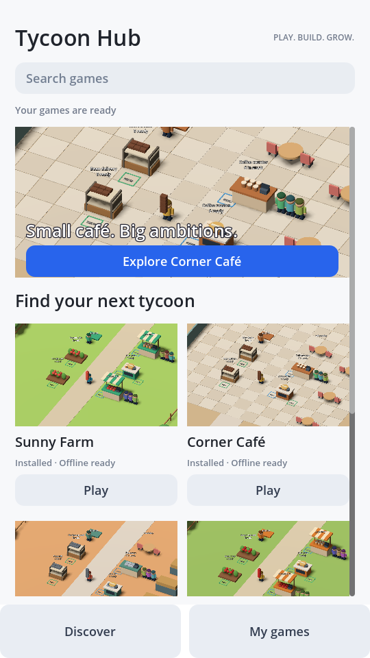
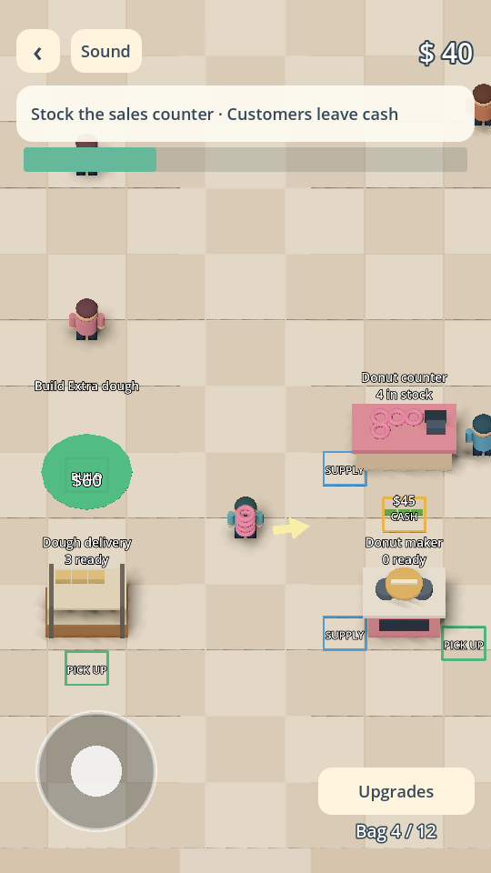

# Tycoon Hub

One native **Android + iOS** app for browsing, downloading, and playing a collection of tycoons. Games are data packs served by static HTTPS hosting. The shared Godot 4.5.1 runtime handles movement, production, shops, customer queues, helpers, upgrades, and saves.

The app has a fixed catalog address. It checks for games automatically on launch and whenever you leave a game. Players browse artwork, search, open a game page, and tap **Get** or **Play**. There is no server address setting. Installed games and the last catalog work offline.



## Games and gameplay

Sunny Farm, Corner Café, and Dusty Depot are bundled. Apple Orchard and Donut Studio are downloadable from the catalog. Donut Studio has two production lines, shops, helpers, and unlockable guest seating.

- Walk with the touch joystick, or WASD/arrows on a computer.
- **Green pickup zone:** collect crops, ingredients, or finished products.
- **Blue supply zone:** deliver the items required by a machine or counter.
- **Yellow cash zone:** collect cash left by customers.
- **Build pad:** stand on an available purchase pad to spend cash gradually and unlock it.
- **Upgrades:** increase carrying capacity or movement speed. Stand near a source, machine, or counter to upgrade its storage and cycle speed.

Customers queue, reach a counter, wait for service, consume stock, then leave. Shops cannot sell without a customer. Hired helpers visibly pick up matching stock and carry it to their assigned station using the central aisle. Production pauses while the app is closed; saves remain separate for each game.



## Play and build

Import `client/project.godot` in **Godot 4.5.1 standard** and run it. No .NET edition or third-party Python modules are required.

[GitHub Actions builds](https://github.com/IveBeenAl0ne/literal-mobile-slop/actions): **Build Tycoon Hub** produces an installable arm64 Android debug APK and an unsigned iPhone IPA/Xcode project. Download artifacts from a successful run for the current commit. The older 0.1 APK has the old library UI; install the 0.2 build to get the redesigned library and gameplay changes. Unsigned iOS IPAs require signing before phone installation. Optional signed iOS export is documented in [docs/builds.md](docs/builds.md).

Both platform builds were verified for the first foundation; updated builds are run on each push. Phone-device testing and credentialed iOS signing remain unverified. The debug Android key is cached between builds: keep that cache to preserve upgrade compatibility and local saves.

## Make and publish a game

From the repository root:

```sh
python server/server.py
```

Open `http://localhost:8787/editor` on your computer and enter the editor token printed in the terminal. Select a starter, clone it with a new ID, edit its layout/economy/colors, and publish. The local program saves `client/packs/<id>.json`. You can also export or edit JSON directly. The local editor is a creation tool; phone players use the fixed public catalog.

To publish publicly:

1. Save the game in `client/packs/<id>.json`. Increase `version` for an update; retain existing station/item IDs to preserve progress.
2. Optionally put a PNG thumbnail in `client/assets/covers/<id>.png` (at most 1 MiB, at most 2048 pixels per side).
3. Run `python tools/export_catalog.py`.
4. Commit the pack, cover, and updated `client/catalog.json` together and push to GitHub.
5. Players see new games on the next launch or return to the library. **No app rebuild is needed for a new pack or thumbnail.**

The catalog contains versions and SHA-256 checksums. The app verifies and validates downloads before installation; cached packs survive connection failures. GitHub raw hosting may take a few minutes to propagate updates. If files are in transition, the app asks the player to retry rather than replacing the installed game.

## Static hosting

The default source is `https://raw.githubusercontent.com/IveBeenAl0ne/literal-mobile-slop/main/client`, configured in the runtime code, with no player-facing setting. To use another host, change `CATALOG_BASE_URL` and rebuild the shared app once.

Only static GET requests are needed:

- `/catalog.json`
- `/packs/<id>.json`
- `/assets/covers/<id>.png` when a cover checksum is present

Export a standalone folder with `python tools/export_catalog.py --output-dir public`, then upload it to any HTTPS host. The phone app does not need the Python server running.

Optional GitHub Pages: set repository **Settings → Pages → Source → GitHub Actions**, then run **Publish catalog to GitHub Pages**. The workflow is manual; rerun it after changing packs. After deployment, its base address is `https://ivebeenal0ne.github.io/literal-mobile-slop`; change the fixed runtime constant if using it instead of raw hosting. Pages does not run Python or accept editor uploads.

## Runtime and checks

Packs support items, production chains, stations, prerequisites, costs, prices, timing, colors, and compound low-poly props. They contain no executable scripts. Adding a core mechanic or importing arbitrary GLB/audio still requires an app update. Current scenery, characters, sounds, and item shapes are generated by the shared runtime. This project is an original reusable tycoon foundation, not a 1:1 Donut Place recreation.

See [docs/pack-format.md](docs/pack-format.md) for the format.

```sh
python tools/export_catalog.py --check
python -m unittest discover -s tests -v
godot --headless --path client --editor --import --quit
godot --headless --path client --script res://tests/test_simulation.gd
godot --headless --path client --script res://tests/test_world.gd
godot --headless --path client --script res://tests/test_polish.gd
```

Actions also tests automatic launch/return catalog refresh, thumbnail downloads, checksum verification, installation, offline catalog preservation, and playing a downloaded game against a plain static HTTP server. Gameplay tests cover both production chains and actual customer/helper behavior. `client/tests/capture.gd` generates the real runtime screenshots used for the thumbnails and documentation.

Code is MIT licensed. Godot is a separate MIT licensed dependency. Reference screenshots and video art have not been copied into the project.
